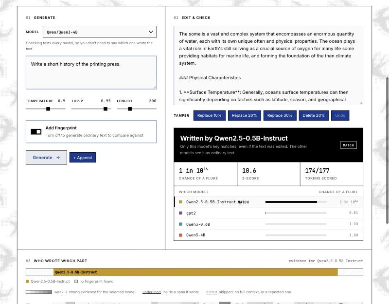

# llm-fingerprinting

A secret-key watermark for LLM output, meant for the Ripple model:

- **Indistinguishable.** Each watermarked token is an exact sample from the
  model's own next-token distribution. Without the key, watermarked text
  can't be told apart from normal sampling; the quality cost is zero.
- **Edit-robust.** Detection uses only local token windows. Substitutions,
  insertions, deletions and splicing into other text remove only the tokens
  near each edit, and the rest still count.
- **Exact false-positive control.** The detector returns a true p-value.
  Unwatermarked text gives uniform p-values, and you choose the threshold
  (default `1e-5`).

## How it works

At each step, `HMAC(key, last 3 token ids)` seeds a SHAKE-256 stream with one
uniform `u_v` per vocabulary token. Sampling picks `argmax u_v^(1/p_v)`
(the exponential-race / Gumbel-max trick). This gives exactly `P(v) = p_v`,
but tokens with high `u` win more often. The detector recomputes `u` for each
token and sums `-log(1-u)`. Without the watermark that sum is Gamma(n,1), and
the p-value comes from it.

Two details keep the output distribution exact:

- **Repeated-context masking.** If a 3-token context repeats inside a
  response, that step uses ordinary random sampling, and the detector skips it.
- **Entropy gate.** The first ~8 bits of each response use real randomness.
  Asking the same prompt twice then still gives different answers. Without
  this, the watermark would make generation deterministic, and that would give
  it away.

## Usage

```python
from ripple_fingerprint import Watermarker
wm = Watermarker(key=SECRET_KEY)          # >=16 bytes; keep it server-side

# inside the model's sampling loop, replacing the usual multinomial draw:
state = wm.new_state()                    # one per response
tok = wm.sample(probs, history_token_ids, state)   # probs: after temperature/top-p

# later, on any text:
result = wm.detect(tokenizer.encode(text, add_special_tokens=False))
result.is_watermarked, result.p_value
```

With Hugging Face, keep your usual `generate` call:

```python
from ripple_fingerprint.hf import watermark_generate, detect_text
ids = watermark_generate(model, tokenizer, wm, temperature=0.8, top_p=0.95,
                         max_new_tokens=300, **inputs)   # batches fine; no beam search
detect_text(text, tokenizer, wm).is_watermarked
```

Or pass `WatermarkLogitsProcessor(wm, temperature, top_k, top_p)` in your
own `logits_processor` list with `do_sample=False`. See `examples/demo_hf.py`.

## Which model wrote it?

Give every model its own key, derived from one master secret, and the detector
can tell them apart:

```python
from ripple_fingerprint import ModelRegistry
reg = ModelRegistry(master_key=MASTER_SECRET)        # >=16 bytes; the only secret
wm_big   = reg.register("ripple-65b", tokenizer_big)  # each returns that model's Watermarker:
wm_small = reg.register("ripple-8b",  tokenizer_small)  # use it in that model's sampling loop

res = reg.attribute(text)        # re-tokenizes with each model's own tokenizer
res.best                         # "ripple-65b", or None if no model's watermark is there
res.matches                      # every model present (more than one for a mixed document)
res.models                       # per-model p-values, most significant first
res.spans                        # which stretch of text came from which model (character ranges)
```

- **No mix-ups between models.** Under a key that didn't generate the text,
  the score is exactly that of ordinary text. So model A's output can't be
  pinned on model B any more often than ordinary text would be. This holds
  even for models that share a tokenizer, like Qwen3-4B and Qwen3-0.6B.
- **One false-positive budget.** Each model gets two tests: the whole text,
  and the best-scoring stretches of it. Both are corrected for every model
  and every possible stretch. The chance that *any* model is named for text
  it didn't write stays below `fpr`.
- **Mixed documents are split.** `spans` finds the stretches carrying each
  model's watermark, with exact edges in our tests. A short passage diluted
  by a long human-written document can still match through its span.
- **The label is the key.** The key comes from `HMAC(master, label)`. Renaming
  a model changes its key, so pass `key_id="ripple-65b"` to keep a stable
  label when the display name or checkpoint path changes.
- **Only your models.** This identifies models that sample with these keys.
  It can't say whether text came from someone else's model.

With already-tokenized input from models that share a tokenizer, use
`reg.attribute_ids(token_ids)`.



**A document stitched together from two models**, split by source in the demo's
"Who wrote which part" view. The bar across the top shows each span's model:
Qwen2.5-0.5B-Instruct wrote the opening and the numbered list, and Qwen3-0.6B
wrote the closing paragraphs. The hatched gaps are where neither fingerprint is
strong enough to call. In the text, tokens are shaded by their evidence for the
selected model, its span is underlined, and dotted tokens are the ones the
detector skips.


## Demo website

```bash
.venv/bin/pip install -e '.[demo]'
.venv/bin/python -m demo.server          # then open http://localhost:8000
```

On the page you can:

- Generate text with the fingerprint on or off.
- Edit the text by hand, or use the tamper buttons to replace or delete random words.
- See whether the fingerprint survives, and **which model wrote it**: every
  model is tested and ranked, with a token-by-token heatmap of where the evidence is.
- Use **+ Append** with different models to build a mixed document, and see
  which part came from which model.
- **Run every model** on one prompt (section 04). Each answer is checked against
  every key, which gives a who-wrote × which-key matrix. The diagonal lights up
  and nothing else does. Models are swapped in and out of memory as needed
  (`RIPPLE_FP_MAX_LOADED`, default 2).

It offers every MLX model in LM Studio's `~/.lmstudio/models`, plus the Hugging
Face models in `RIPPLE_FP_MODELS` (default: Qwen3-4B, Qwen3-0.6B,
Qwen2.5-0.5B-Instruct, gpt2, gpt2-large). To serve Ripple from a machine with enough GPU,
add `ricursiveAI/Ripple-65B-Preview` (or a local path) to `RIPPLE_FP_MODELS`. For more
than one GPU, also install `accelerate`. The master key comes from `RIPPLE_FP_KEY`, or
is created once in `demo/.demo_key` (gitignored). Each model's key is derived
from it and the model id, so text generated before per-model keys existed no
longer checks out.

## Measured results

**GPT-2, 200-token generations, T=0.8, top-p=0.95**, with random words
replaced. "Detected" means p < 1e-5:

| context_width | clean | 10% words | 20% words | 30% words |
|---|---|---|---|---|
| 2 | 100% | 100% | 100% | 100% (median p 5e-11) |
| **3 (default)** | 100% | 100% | 100% | 100% (median p 7e-13) |
| 4 | 100% | 100% | 90% | 70% |

**Quality:** with the same settings, mean NLL of watermarked GPT-2 text is
4.02 ± 0.11, against 4.19 ± 0.10 for plain sampling. The difference is within
noise. Plain GPT-2 samples were never flagged.

**Toy LM at about 3 bits/token** (a stand-in for a lower-entropy chat
model), with random *token* substitutions:

| tokens | clean | 20% substituted | 40% substituted |
|---|---|---|---|
| 100 | 100% | 63% | 0% |
| 200 | 100% | 97% | 3% |
| 400 | 100% | 100% | 10% |

GPT-2 has more randomness per token than a tuned chat model does, so run
`tests/test_hf.py` on Ripple itself (`RIPPLE_FP_TEST_MODEL=/path/to/ripple`)
to get its real numbers.

## Limits

- **Heavy paraphrasing or translation removes it.** No token-level watermark
  survives a full rewrite, because the meaning stays but the tokens change.
  The signal fades as the fraction of untouched 4-token runs shrinks.
- **Low-entropy text barely carries it.** Code, lists and factual one-liners
  have little randomness to hide a signal in, so they need more tokens.
- **Greedy decoding (T=0) has nothing to watermark.**
- **The key is the whole secret.** Anyone who has it can detect, and also
  forge or strip the watermark. Run detection as a service; don't ship the key.
- **`context_width` is a trade-off.** A smaller value is more robust to edits.
  A larger value repeats contexts less often across responses, which helps
  indistinguishability when many responses are compared.

## Development

```bash
python3 -m venv .venv && .venv/bin/pip install -e '.[test]'
.venv/bin/python -m pytest -q
```
