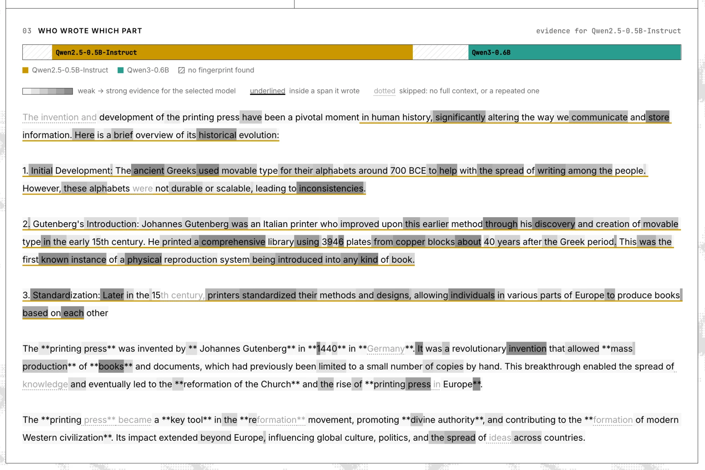
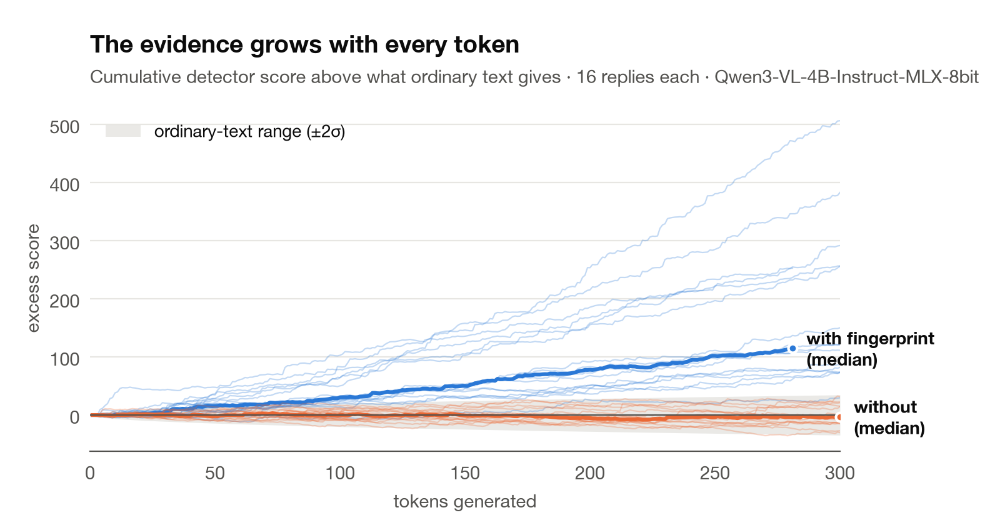
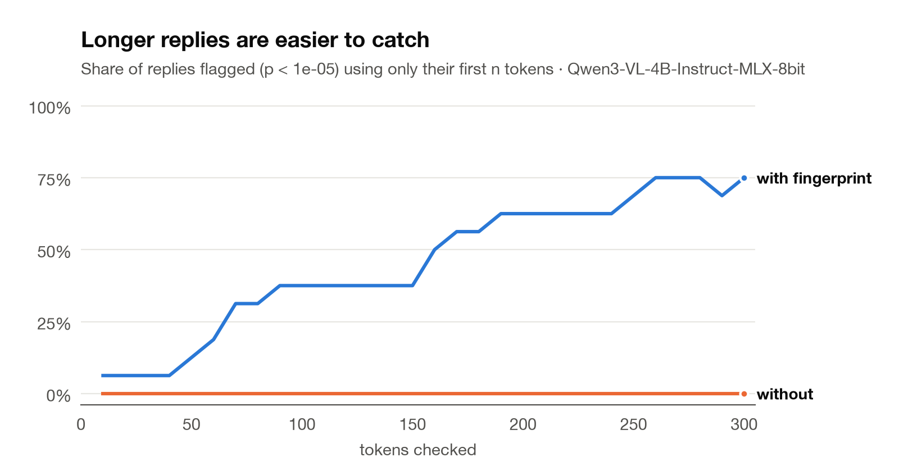
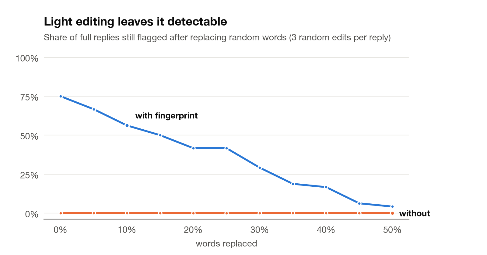
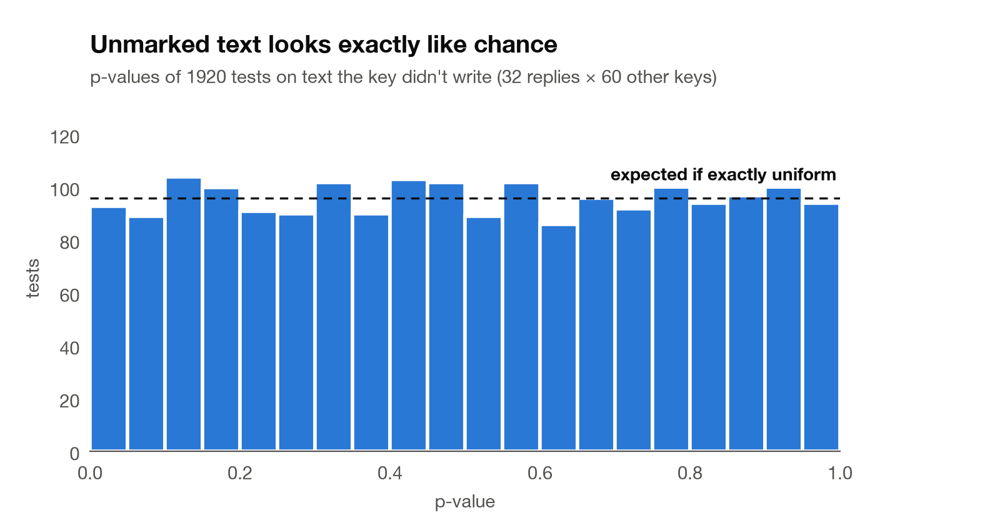
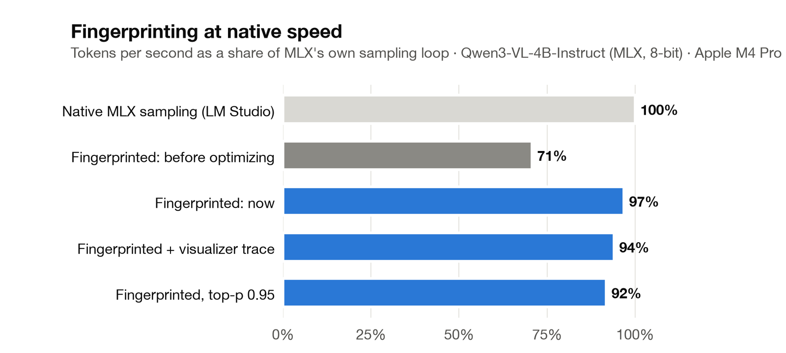
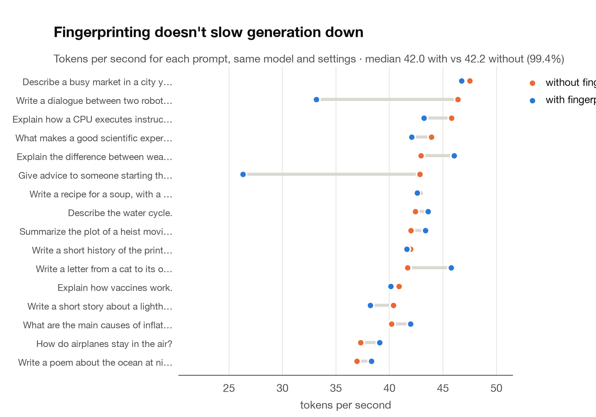
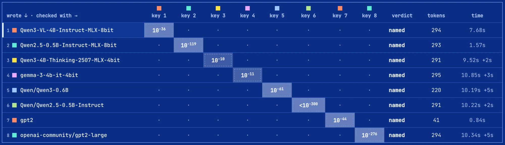

<h1 align="center">Ripple Fingerprint</h1>

<p align="center">
  <b>An invisible, edit-robust watermark for LLM output.</b><br>
  Fingerprinted text reads exactly like normal sampling. With the key, you can prove
  which model wrote it, even after editing or mixing.
</p>

<p align="center">
  <a href="#results">Results</a> ·
  <a href="#how-it-works">How it works</a> ·
  <a href="#quick-start">Quick start</a> ·
  <a href="#which-model-wrote-it">Which model wrote it?</a> ·
  <a href="#demo-website">Demo</a> ·
  <a href="#limits">Limits</a>
</p>



## At a glance

| | |
|---|---|
| **Invisible** | Every token is an exact sample from the model's own distribution. There is no quality cost, and nothing to detect without the key. |
| **Provable** | The detector returns an exact p-value. On Qwen3-VL-4B, 12 of 16 300-token replies were flagged at p < 10⁻⁵ (median p ≈ 10⁻¹⁰), and 0 of 16 plain replies were. |
| **Edit-robust** | Each edit only erases the ~4 tokens around it. On GPT-2, 200-token replies are still caught every time with 30% of their words replaced. |
| **Attributable** | Per-model keys from one master secret say *which* model wrote a text, and which part of a mixed document. |
| **Fast** | 97% of native MLX speed on an M4 Pro. The key hashing overlaps with the GPU. |

## Results

Measured on **Qwen3-VL-4B-Instruct (MLX, 8-bit)**, a confident chat model and
the hardest case: 16 prompts, one fingerprinted and one plain reply each,
300 tokens, temperature 1.0. Charts are rebuilt by [`docs/make_charts.py`](docs/make_charts.py).

**The evidence builds up token by token.** Fingerprinted replies climb steadily
out of the band ordinary text stays in. How fast depends on how much randomness
the reply has: stories climb fastest, factual answers slowest.



**Longer replies are easier to catch.** At the strict p < 10⁻⁵ threshold, about
a third of replies are caught after 100 tokens, and three quarters by 300.
Plain replies never are.



**Light editing leaves it detectable.** Replacing random words removes the
signal gradually, not all at once. Edits never create false alarms.



**No false alarms.** Testing text that a key didn't write gives perfectly
uniform p-values, so the threshold you set is the false-positive rate you get.
The smallest of 1,920 such p-values was 5 × 10⁻⁴.



**It runs at native speed.** The key hash for the next token is computed
while the GPU is still producing it, and the race itself is one division over
the vocabulary.



**Fingerprint on or off, generation runs just as fast.** Each prompt is run
several times both ways, alternating so background load hits both equally.
The two dots overlap prompt by prompt.



<details>
<summary><b>More measurements</b>: GPT-2, context width, quality, toy model</summary>

**GPT-2, 200-token generations, T=0.8, top-p=0.95**, with random words
replaced. "Detected" means p < 10⁻⁵:

| context_width | clean | 10% words | 20% words | 30% words |
|---|---|---|---|---|
| 2 | 100% | 100% | 100% | 100% (median p 5e-11) |
| **3 (default)** | 100% | 100% | 100% | 100% (median p 7e-13) |
| 4 | 100% | 100% | 90% | 70% |

**Quality:** with the same settings, mean NLL of watermarked GPT-2 text is
4.02 ± 0.11, against 4.19 ± 0.10 for plain sampling. The difference is within
noise. Plain GPT-2 samples were never flagged.

**Toy LM at about 3 bits/token**, with random *token* substitutions:

| tokens | clean | 20% substituted | 40% substituted |
|---|---|---|---|
| 100 | 100% | 63% | 0% |
| 200 | 100% | 97% | 3% |
| 400 | 100% | 100% | 10% |

GPT-2 has far more randomness per token (about 3 bits) than a tuned chat model
(0.35–1.4 bits), which is why it's caught sooner. To measure Ripple itself, run
`tests/test_hf.py` with `RIPPLE_FP_TEST_MODEL=/path/to/ripple`.

</details>

## How it works

Every token is picked by a race. Each candidate token *v* gets a random draw
*u<sub>v</sub>*, and the winner is the token that arrives first:

```
next token = argmin over v of  −ln(u_v) / p_v
```

If the draws are fresh random numbers, this picks *v* with probability exactly
*p<sub>v</sub>*. That's the exponential race, also known as the Gumbel-max trick.
The fingerprint changes only where the draws come from: they are the output of
`SHAKE-256(HMAC(key, last 3 token ids))`. To anyone without the key they are
indistinguishable from fresh randomness. The detector recomputes them and sees
that the winners kept drawing *u* close to 1.

It sums `−ln(1 − u)` over the text's tokens. For text the key didn't write, that
sum is exactly Gamma(n, 1), which gives an exact p-value. The seed depends only
on the local context, so an edit only spoils the few tokens whose context it
touches.

Two details keep the output distribution exact:

- **Repeated-context masking.** If a 3-token context repeats inside a
  response, that step uses ordinary random sampling, and the detector skips it.
- **Entropy gate.** The first ~8 bits of each response use real randomness.
  Asking the same prompt twice then still gives different answers. Without
  this, the watermark would make generation deterministic, and that would give
  it away.

## Quick start

```python
from ripple_fingerprint import Watermarker
wm = Watermarker(key=SECRET_KEY)          # >=16 bytes; keep it server-side

# inside the model's sampling loop, replacing the usual multinomial draw:
state = wm.new_state()                    # one per response
tok = wm.sample(probs, history_token_ids, state)   # probs: after temperature/top-p

# later, on any text:
result = wm.detect(tokenizer.encode(text, add_special_tokens=False))
result.is_watermarked, result.p_value
```

**Hugging Face:** keep your usual `generate` call.

```python
from ripple_fingerprint.hf import watermark_generate, detect_text
ids = watermark_generate(model, tokenizer, wm, temperature=1.0,
                         max_new_tokens=300, **inputs)   # batches fine; no beam search
detect_text(text, tokenizer, wm).is_watermarked
```

Or pass `WatermarkLogitsProcessor(wm, temperature, top_k, top_p)` in your own
`logits_processor` list with `do_sample=False`. See `examples/demo_hf.py`.

**Apple MLX** (for example LM Studio's models), at near-native speed:

```python
from mlx_lm import load
from ripple_fingerprint.mlx import generate
model, tok = load("~/.lmstudio/models/lmstudio-community/Qwen3-VL-4B-Instruct-MLX-8bit")
text = generate(model, tok, "Write a short story.", wm, max_new_tokens=300)
```

> [!TIP]
> Use **temperature 1.0 with top-p off** for chat models. The fingerprint rides
> on randomness, and confident models have little of it to spare. Lower
> temperatures and top-p truncation remove most of what's left.

## Which model wrote it?

Give every model its own key, derived from one master secret, and the detector
can tell them apart:

```python
from ripple_fingerprint import ModelRegistry
reg = ModelRegistry(master_key=MASTER_SECRET)        # >=16 bytes; the only secret
wm_big   = reg.register("ripple-65b", tokenizer_big)  # each returns that model's Watermarker:
wm_small = reg.register("ripple-8b",  tokenizer_small)  # use it in that model's sampling loop

res = reg.attribute(text)        # re-tokenizes with each model's own tokenizer
res.best                         # "ripple-65b", or None if no model's watermark is there
res.matches                      # every model present (more than one for a mixed document)
res.models                       # per-model p-values, most significant first
res.spans                        # which stretch of text came from which model (character ranges)
```

- **No mix-ups between models.** Under a key that didn't generate the text,
  the score is exactly that of ordinary text. So model A's output can't be
  pinned on model B any more often than ordinary text would be. This holds
  even for models that share a tokenizer, like Qwen3-4B and Qwen3-0.6B.
- **One false-positive budget.** Each model gets two tests: the whole text,
  and the best-scoring stretches of it. Both are corrected for every model
  and every possible stretch. The chance that *any* model is named for text
  it didn't write stays below `fpr`.
- **Mixed documents are split.** `spans` finds the stretches carrying each
  model's watermark, with exact edges in our tests. A short passage diluted
  by a long human-written document can still match through its span.
- **The label is the key.** The key comes from `HMAC(master, label)`. Renaming
  a model changes its key, so pass `key_id="ripple-65b"` to keep a stable
  label when the display name or checkpoint path changes.
- **Only your models.** This identifies models that sample with these keys.
  It can't say whether text came from someone else's model.

With already-tokenized input from models that share a tokenizer, use
`reg.attribute_ids(token_ids)`.

**Edited text is still attributed.** With 10% of its words replaced, this reply
is still named as Qwen2.5-0.5B-Instruct's, and the other models see ordinary text.


**Mixed documents are split by source** (the image at the top of this page).
The bar across the top shows each span's model: Qwen2.5-0.5B-Instruct wrote the
opening and the numbered list, and Qwen3-0.6B wrote the closing paragraphs. The
hatched gaps are where neither fingerprint is strong enough to call. In the
text, tokens are shaded by their evidence for the selected model, its span is
underlined, and dotted tokens are the ones the detector skips.

**Every model, every key.** Each of the eight models answered the same prompt
with its fingerprint on, and each answer was checked against all eight keys.
Only the model's own key fires (p from 10⁻¹⁰ for Qwen3-4B-Thinking down to
below 10⁻³⁰⁰ for Qwen2.5-0.5B-Instruct), and every other cell is a dot, so all
eight are named correctly. The confident chat models (Qwen3-4B-Thinking, Gemma 3
4B) give the weakest evidence, since there is less randomness per token to carry
the fingerprint.



## Demo website

```bash
.venv/bin/pip install -e '.[demo]'
.venv/bin/python -m demo.server          # then open http://localhost:8000
```

On the page you can:

- **Generate** text with the fingerprint on or off. Tokens stream in live, and
  the evidence builds up as they arrive.
- **Edit** the text by hand, or use the tamper buttons to replace or delete random words.
- See whether the fingerprint survives, and **which model wrote it**: every
  model is tested and ranked, with a token-by-token heatmap of where the evidence is.
- Use **+ Append** with different models to build a mixed document, and see
  which part came from which model.
- **Run every model** on one prompt (section 04). Each answer is checked against
  every key, which gives a who-wrote × which-key matrix. The diagonal lights up
  and nothing else does. Models are swapped in and out of memory as needed
  (`RIPPLE_FP_MAX_LOADED`, default 2).
- **Watch the sampler** at [`/static/sampler-demo.html`](demo/static/sampler-demo.html):
  each token's race animated live as the model streams, showing the top
  candidates, their probabilities and keyed draws, and the detector's evidence
  climbing out of the ordinary-text band. Switch the key off to compare.

It offers every MLX model in LM Studio's `~/.lmstudio/models`, plus the Hugging
Face models in `RIPPLE_FP_MODELS` (default: Qwen3-0.6B,
Qwen2.5-0.5B-Instruct, gpt2, gpt2-large). To serve Ripple from a machine with enough GPU,
add `ricursiveAI/Ripple-65B-Preview` (or a local path) to `RIPPLE_FP_MODELS`. For more
than one GPU, also install `accelerate`. The master key comes from `RIPPLE_FP_KEY`, or
is created once in `demo/.demo_key` (gitignored). Each model's key is derived
from it and the model id, so text generated before per-model keys existed no
longer checks out.

## Limits

- **Heavy paraphrasing or translation removes it.** No token-level watermark
  survives a full rewrite, because the meaning stays but the tokens change.
  The signal fades as the fraction of untouched 4-token runs shrinks.
- **Low-entropy text barely carries it.** Code, lists and factual one-liners
  have little randomness to hide a signal in, so they need more tokens.
  Confident chat models carry 0.35–1.4 bits per token, against about 3 for GPT-2.
- **Greedy decoding (T=0) has nothing to watermark.**
- **The key is the whole secret.** Anyone who has it can detect, and also
  forge or strip the watermark. Run detection as a service; don't ship the key.
- **`context_width` is a trade-off.** A smaller value is more robust to edits.
  A larger value repeats contexts less often across responses, which helps
  indistinguishability when many responses are compared.

## Development

```bash
python3 -m venv .venv && .venv/bin/pip install -e '.[test]'
.venv/bin/python -m pytest -q
```

To rebuild the charts (MLX on Apple Silicon; about 4 minutes):

```bash
PYTHONPATH=. .venv/bin/python docs/run_experiment.py experiment.json
PYTHONPATH=. .venv/bin/python docs/run_speed.py docs/speed-pairs.json
.venv/bin/python docs/make_charts.py experiment.json
```

The speed chart reads [`docs/speed.json`](docs/speed.json), measured with
interleaved runs against native MLX sampling.
